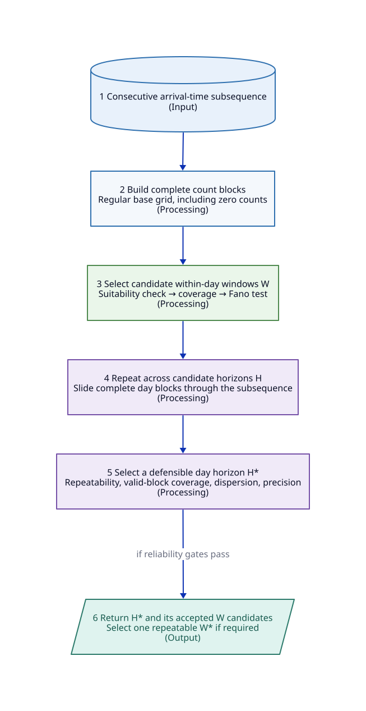

---
header-includes:
  - |
    \usepackage{algorithm}
    \usepackage{algpseudocode}
---

# Nested selection of Poisson-compatible count windows

## Objective

Let an observed arrival-time stream be represented by an ordered sequence
\(T=(t_1,\ldots,t_N)\), with \(t_1\leq\cdots\leq t_N\). The analysis is
performed on a consecutive, bounded subsequence of this stream. The subsequence
contains the complete set of observed arrivals between its reported endpoints;
it is not formed by randomly selecting or thinning individual timestamps.

The objective is to identify a nested pair of time scales for which a
homogeneous Poisson assumption is statistically reasonable:

1. a within-day aggregation window \(W\), such as two hours; and
2. a day horizon \(H\), such as seven or fourteen days.

A selected pair \((W^*,H^*)\) has two linked interpretations. First, counts in
consecutive windows of width \(W^*\) have dispersion consistent with a
homogeneous Poisson model within an \(H^*\)-day block. Second, the choice of
\(H^*\) is repeatable across successive blocks without introducing substantial
loss of within-day Poisson compatibility. Thus the method seeks not merely a
short interval that happens to pass a test, but a day horizon over which the
within-day homogeneous Poisson description remains reasonable.

The implementation deterministically selects \(H^*\) and retains the complete
set of accepted within-day candidates. A unique \(W^*\), needed for a single
nested pair, must be selected by an additional prespecified rule that
emphasizes repeatability of the same \(W\) across the evaluated blocks. Here,
“Poisson-compatible” means that the stated dispersion diagnostic does not
reject the null model; it is an evidential assessment rather than a proof.

## Notation

| Symbol | Definition |
|:--|:--|
| \(\Delta\) | Base temporal resolution at which complete counts are constructed |
| \(q\) | Positive integer number of base-resolution intervals in a candidate window |
| \(W=q\Delta\) | Candidate within-day aggregation window |
| \(\mathcal H\) | Set of candidate day horizons |
| \(\mathcal W\) | Set of candidate within-day windows, expressed in units of \(\Delta\) |
| \(H\in\mathcal H\) | Candidate day horizon |
| \(s_H\) | Step size used to advance blocks of length \(H\) |
| \(B_{H,r}=[b_{H,r},b_{H,r}+H)\) | \(r\)th half-open evaluation block for candidate \(H\) |
| \(C^{(H,r)}_j\) | Arrival count in base interval \(j\) of block \(B_{H,r}\) |
| \(N^{(H,r,W)}_i\) | Arrival count in the \(i\)th non-overlapping window of width \(W\) in \(B_{H,r}\) |
| \(m_{H,r,W}\) | Number of complete windows of width \(W\) in \(B_{H,r}\) |
| \(1-\alpha\) | Nominal confidence level for the Fano-dispersion diagnostic |
| \(m_{\min}\) | Minimum required number of complete windows |
| \(\bar C_{\min}\) | Minimum acceptable mean base-interval count |
| \(z_{\max}\) | Maximum acceptable proportion of zero-count base intervals |

All timestamps within an analysis are required to follow a consistent
timezone policy. Duplicate arrival timestamps are retained because two or more
events can occur at the same recorded time. Intervals are half-open: an arrival
at the left endpoint is included and an arrival at the right endpoint is
excluded.

## Data preparation

For a requested block \(B=[t,t+H)\), arrivals are aggregated on the regular
base-resolution grid

\[
[t+j\Delta,t+(j+1)\Delta),\qquad j=0,\ldots,K_H-1,
\]

where \(K_H=\lfloor H/\Delta\rfloor\). If \(H\) is not an exact multiple of
\(\Delta\), the implementation places only the \(K_H\) complete intervals in
the count series and reports the residual
\(H-K_H\Delta\) as remainder metadata; it does not treat the residual as a
complete base interval. The resulting counts are

\[
C_j=\sum_{\ell=1}^{N}
\mathbf 1\!\left\{t+j\Delta\leq t_\ell<t+(j+1)\Delta\right\}.
\]

Every base interval is represented explicitly, including intervals for which
\(C_j=0\). This is essential: conditioning on intervals in which at least one
event occurred would alter the zero-count structure and bias the subsequent
dispersion assessment. By default, a block is analyzed only when the source
data cover the full requested interval \([t,t+H)\); any truncation policy must
report the requested and actual bounds.

## Suitability screen

Before any variance-based diagnostic is calculated, the base-resolution
series is screened for density and zero inflation. For a block containing
\(K_H\) base counts, define

\[
\bar C=\frac{1}{K_H}\sum_{j=0}^{K_H-1}C_j
\]

and

\[
z_0=\frac{1}{K_H}\sum_{j=0}^{K_H-1}\mathbf 1\{C_j=0\}.
\]

The block is suitability-valid if

\[
\bar C\geq\bar C_{\min}
\qquad\text{and}\qquad
z_0\leq z_{\max}.
\]

Otherwise, no Poisson-equidispersion test is performed for that block. These
two comparisons are operational eligibility criteria, not statistical
hypothesis tests. They delimit the intended high-rate, non-hurdle use case and
are reported separately from the statistical decision.

## Statistical model and Fano-dispersion test

For a fixed suitability-valid \(H\)-day block, candidate within-day window
\(W=q\Delta\), and complete-window count
\(m=m_{H,r,W}=\lfloor K_H/q\rfloor\), define

\[
N_i=\sum_{j=(i-1)q}^{iq-1}C_j,\qquad i=1,\ldots,m.
\]

Under a homogeneous Poisson process with constant arrival rate \(\lambda\),
the increments in disjoint intervals of length \(W\) are independent and
identically distributed, with

\[
N_i\sim\operatorname{Poisson}(\lambda W)
\]

and hence \(\operatorname{E}(N_i)=\operatorname{Var}(N_i)=\lambda W\).
The corresponding equidispersion hypothesis is

\[
H_0:\frac{\operatorname{Var}(N_i)}
{\operatorname{E}(N_i)}=1,
\qquad
H_1:\frac{\operatorname{Var}(N_i)}
{\operatorname{E}(N_i)}\ne 1.
\]

Let

\[
\bar N=\frac{1}{m}\sum_{i=1}^{m}N_i,
\qquad
S_N^2=\frac{1}{m-1}\sum_{i=1}^{m}(N_i-\bar N)^2,
\qquad
\widehat F_W=\frac{S_N^2}{\bar N}.
\]

The sample Fano factor is the dispersion test statistic. Its population value
is one under \(H_0\); values above one indicate excess variance relative to the
mean, while values below one indicate underdispersion.

Applying the diagnostic to the complete sequence of \(W\)-wide counts within
the block asks whether aggregation across the selected days has preserved the
Poisson variance-to-mean relationship at that within-day scale. Systematic
day-to-day variation in arrival level can increase between-day variation and
move the Fano statistic outside the Poisson reference interval. An accepted
\(W\) over \(H\) therefore supports the homogeneous Poisson simplification
across the selected multi-day block at that resolution.

For independent Poisson observations, a standard approximate reference
distribution is

\[
\nu \widehat F_W\mathrel{\dot\sim}\chi^2_\nu,
\qquad \nu=m-1.
\]

Thus the two-sided \(100(1-\alpha)\%\) reference interval for the Fano factor
under \(H_0\) is

\[
\mathcal I_{1-\alpha}
=
\left[
\frac{\chi^2_{\alpha/2,\nu}}{\nu},
\frac{\chi^2_{1-\alpha/2,\nu}}{\nu}
\right].
\]

Candidate \((H,r,W)\) is accepted when
\[
m\geq m_{\min},\qquad \bar N>0,
\qquad\text{and}\qquad
\widehat F_W\in\mathcal I_{1-\alpha}.
\]

Equivalently, the procedure fails to reject \(H_0\) at nominal level
\(\alpha\). A candidate is rejected for insufficient coverage when
\(m<m_{\min}\), or rejected for dispersion when
\(\widehat F_W\notin\mathcal I_{1-\alpha}\). The implementation requires
\(\bar N>0\) and raises an error rather than returning an accepted or rejected
diagnostic if the aggregated candidate mean is zero.

Writing \(X_\nu=\nu\widehat F_W\) and denoting the \(\chi^2_\nu\) cumulative
distribution function by \(G_\nu\), the equivalent two-sided approximate
\(p\)-value is

\[
p_W
=
2\min\left\{G_\nu(X_\nu),\,1-G_\nu(X_\nu)\right\},
\]

truncated at one. The acceptance rule is then \(p_W\geq\alpha\), subject to the
same suitability and coverage requirements. The reference interval is used in
the implementation and exposes the observed distance to both rejection
boundaries; the interval and \(p\)-value formulations are equivalent for the
central, equal-tail two-sided test.

The chi-square approximation requires sufficiently many counts and independent,
identically distributed Poisson increments. It tests the equidispersion
implied by the homogeneous Poisson model. Failure to detect a violation
supports treating homogeneous Poisson counts as reasonable at the selected
resolution; it does not prove that every point-process property holds. No
multiplicity adjustment is applied across candidate windows or sliding blocks,
so the outputs form an explicit, reproducible model-compatibility selection
procedure rather than a familywise confirmatory test.

## First stage: evaluate within-day windows inside one block

For each fixed block \(B_{H,r}\), apply the suitability screen once. If the
block passes, evaluate each \(W\in\mathcal W\) that leaves at least
\(m_{\min}\) complete non-overlapping windows. For each evaluated candidate,
report \(m\), \(\bar N\), \(S_N^2\), \(\widehat F_W\), the endpoints of
\(\mathcal I_{1-\alpha}\), its width

\[
D_W=
\frac{\chi^2_{1-\alpha/2,m-1}
-\chi^2_{\alpha/2,m-1}}{m-1},
\]

and the acceptance decision.

Define the block-level outcome

\[
A_{H,r}
=
\mathbf 1\left\{
\exists\,W\in\mathcal W:
W\text{ is accepted in }B_{H,r}
\right\}.
\]

If several windows are accepted, their individual diagnostics are retained;
the block is not represented by a single \(A_{H,r}\) alone.

## Second stage: compare day horizons by repeated blocks

For each \(H\in\mathcal H\), form successive complete blocks beginning at
\(b_{H,1}\) and advancing by \(s_H\) until no further complete block fits
within the observed subsequence. Sliding blocks may overlap, so block outcomes
should not be treated as independent replicates.

This stage assesses the stability of the within-day homogeneous Poisson
assumption. A horizon is defensible when that assumption is supported in a
sufficiently large proportion of blocks, with adequate valid-block coverage,
small departure from equidispersion, and useful diagnostic precision. A
horizon is rejected when it captures too much day-to-day variation or when its
acceptance is based on too few suitable blocks to support a reliable
conclusion.

Let \(R_H\) be the number of attempted blocks, \(V_H\) the number of
suitability-valid blocks, and \(A_H=\sum_{r\in\mathcal V_H}A_{H,r}\) the
number of suitability-valid blocks for which at least one within-day candidate
was accepted. Here, \(\mathcal V_H\) indexes suitability-valid blocks,
including valid blocks in which none of the candidate windows has adequate
coverage.

The main horizon-level summaries are

\[
P_H=\frac{V_H}{R_H}
\]

and

\[
Q_H=
\begin{cases}
A_H/V_H, & V_H>0,\\
\text{undefined}, & V_H=0.
\end{cases}
\]

Thus \(P_H\) is the suitability-valid proportion and \(Q_H\) is the conditional
Poisson-acceptance rate. \(Q_H\) is undefined when \(V_H=0\); reporting it as
zero would incorrectly convert an absence of evidence into a failed
diagnostic. Two additional summaries are computed over all candidate-window
evaluations that reached the Fano diagnostic:

\[
\overline D_H
=\operatorname{mean}(D_W)
\]

and

\[
M_H=\operatorname{median}\left(\left|\widehat F_W-1\right|\right).
\]

The former measures average reference-interval width, and the latter measures
typical departure from Poisson equidispersion.

## Horizon recommendation rule

Let \(p_{\min}\), \(v_{\min}\), and \(\epsilon\) denote, respectively, the
minimum required suitability-valid proportion, minimum required number of
suitability-valid blocks, and acceptance-rate tolerance. A candidate horizon
first passes the reliability gate if

\[
Q_H\text{ is defined},\qquad P_H\geq p_{\min},\qquad V_H\geq v_{\min}.
\]

Among reliability-qualified horizons, let

\[
Q_{\max}=\max_H Q_H.
\]

Retain every horizon satisfying

\[
Q_H\geq Q_{\max}-\epsilon.
\]

Rank the retained horizons lexicographically by:

1. smallest \(M_H\);
2. smallest \(\overline D_H\); and
3. shortest \(H\), unless the longer-horizon preference is explicitly
   configured.

If no horizon passes the reliability gate, the procedure returns no
recommendation. Every candidate receives an audit record identifying whether
it was selected, retained as a runner-up, or rejected and, for rejected
candidates, the specific gate and observed-versus-required values.

## Selection and reporting of the nested pair

The implemented horizon recommender returns \(H^*\). For a unique nested
\((W^*,H^*)\), the choice of \(W^*\) among the accepted windows in the
diagnostic records for \(H^*\) must also be prespecified. A conservative
substantively aligned extension is to rank \(W\) first by the proportion of
suitability-valid \(H^*\) blocks in which it is accepted, then by its median
\(|\widehat F_W-1|\), and then by the intended operational preference. The
selected rule should be fixed before inspecting the results, and the software
output should report all accepted \(W\) values so that the final choice remains
transparent. This same-\(W\) repeatability criterion is essential: the desired
conclusion is not that a potentially different within-day scale passes in each
block, but that the same selected \(W^*\) remains compatible with a
homogeneous Poisson assumption over the selected horizon.

The minimum reporting set for a journal study is:

- the arrival-time source, observation span, and definition of the consecutive
  subsequence;
- \(\Delta\), \(\mathcal W\), \(\mathcal H\), \(s_H\), boundary policy, and
  timezone policy;
- \(\bar C_{\min}\), \(z_{\max}\), \(m_{\min}\), and \(1-\alpha\);
- for each block, suitability diagnostics, evaluated and accepted windows,
  Fano statistics, confidence bounds, and reasons for rejection;
- for each horizon, \(R_H\), \(V_H\), \(A_H\), \(P_H\), \(Q_H\),
  \(\overline D_H\), and \(M_H\), with undefined values retained as undefined;
- the horizon reliability thresholds, tolerance, tie-break configuration, and
  complete candidate audit; and
- the prespecified rule used to identify \(W^*\), if a unique nested pair is
  required.

Because the final result is scale- and sample-dependent, the recommended
horizon and accepted within-day window set—and any study-specific
\((W^*,H^*)\) derived from them—state that a homogeneous Poisson assumption is
reasonable for the selected within-day counts over the selected multi-day
block. This is a local, resolution-specific justification for the horizon,
not a claim that the entire arrival process has one global rate.

For the current implementation, the default operational settings are
\(\bar C_{\min}=5\), \(z_{\max}=0.10\), \(m_{\min}=30\), and
\(1-\alpha=0.90\). The default horizon recommendation settings are
\(p_{\min}=0.80\), \(v_{\min}=10\), \(\epsilon=0.02\), and a preference for
the shorter horizon after the preceding gates and tie-breaks. Any study that
uses different settings must report the study-specific values.

## Algorithmic workflow

